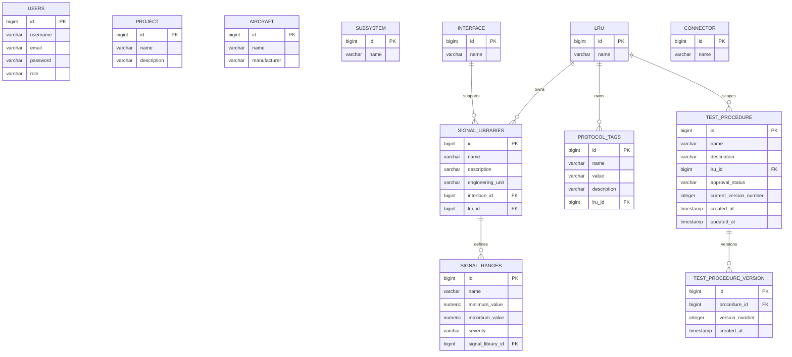

# IATERAP Database Design

| Document Information | Details |
|---|---|
| Jira | AI-151 [T3-DOC] Database design document (started) |
| Document Type | Database Design |
| Status | Started |
| Last Updated | 24 July 2026 |
| Database | PostgreSQL |
| Migration Tool | Flyway |
| Backend ORM | Spring Data JPA / Hibernate |

---

## 1. Purpose

This document records the current IATERAP database schema, entity relationships, constraints, indexes, and seed data.
It is intended to support upcoming Test Procedure Engineering, approval workflow, coverage, and reliability work without relying on tribal knowledge.

The schema is managed through Flyway migrations only. Manual database edits should not be used for project schema changes.

---

## 2. Current Scope

The current schema covers:

- Authentication users and role storage.
- Top-level management entities: Project, Aircraft, Subsystem, Interface, LRU, and Connector.
- Week 3 engineering entities: Signal Library, Signal Range, and Protocol Tag.
- Early Test Procedure/version scaffold required for composite index groundwork.

The following domains are planned but not fully modelled yet:

- Full 17-field Test Step schema.
- Fault Template and FMEA branch mapping.
- Audit log write-through interceptor schema.
- Rule Engine and Coverage Engine tables.
- Reliability analytics reporting tables.

---

## 3. Migration History

| Migration | Purpose |
|---|---|
| `V1__initial_schema.sql` | Creates users and base management tables, plus initial demo users/projects. |
| `V2__week3_signal_library_protocol_tag.sql` | Creates Signal Library, Signal Range, and Protocol Tag tables with FK constraints. |
| `V3__week3_composite_indexes.sql` | Adds composite indexes for Week 3 signal/protocol lookup paths. |
| `V4__procedure_approval_index_scaffold.sql` | Adds minimal Test Procedure/version scaffold and future query-path indexes. |

---

## 4. Entity Relationship Diagram



---

## 5. Table-by-Table Notes

### 5.1 `users`

Stores platform user credentials and role information used by the authentication/RBAC foundation.

| Column | Type | Notes |
|---|---|---|
| `id` | `BIGINT` | Primary key, generated identity. |
| `username` | `VARCHAR(255)` | Login username. |
| `email` | `VARCHAR(255)` | User email; indexed by `idx_user_email`. |
| `password` | `VARCHAR(255)` | Stored credential value for current development/demo setup. |
| `role` | `VARCHAR(255)` | Matches backend `Role` enum values. |

Seed users include `admin`, `syseng`, `reliability`, `tester`, `field`, and `viewer`.

### 5.2 `project`

Stores top-level project/program records used by the management UI.

| Column | Type | Notes |
|---|---|---|
| `id` | `BIGINT` | Primary key, generated identity. |
| `name` | `VARCHAR(255)` | Project name. |
| `description` | `VARCHAR(255)` | Project description. |

Initial seed data includes demo aircraft and reliability validation projects.

### 5.3 `aircraft`

Stores aircraft records.

| Column | Type | Notes |
|---|---|---|
| `id` | `BIGINT` | Primary key, generated identity. |
| `name` | `VARCHAR(255)` | Aircraft name. |
| `manufacturer` | `VARCHAR(255)` | Aircraft manufacturer. |

### 5.4 `subsystem`

Stores aircraft subsystem records.

| Column | Type | Notes |
|---|---|---|
| `id` | `BIGINT` | Primary key, generated identity. |
| `name` | `VARCHAR(255)` | Subsystem name. |

### 5.5 `interface`

Stores interface/bus types such as CAN and ARINC 429.

| Column | Type | Notes |
|---|---|---|
| `id` | `BIGINT` | Primary key, generated identity. |
| `name` | `VARCHAR(255)` | Interface name. |

The table is quoted as `"interface"` in SQL because `interface` is a reserved programming-language term and can be ambiguous in tooling.

### 5.6 `lru`

Stores Line Replaceable Unit records.

| Column | Type | Notes |
|---|---|---|
| `id` | `BIGINT` | Primary key, generated identity. |
| `name` | `VARCHAR(255)` | LRU name. |

LRU acts as the main engineering scope for Signal Libraries, Protocol Tags, and future Test Procedures.

### 5.7 `connector`

Stores connector records.

| Column | Type | Notes |
|---|---|---|
| `id` | `BIGINT` | Primary key, generated identity. |
| `name` | `VARCHAR(255)` | Connector name. |

### 5.8 `signal_libraries`

Stores signals available for an LRU and interface.

| Column | Type | Notes |
|---|---|---|
| `id` | `BIGINT` | Primary key, generated identity. |
| `name` | `VARCHAR(255)` | Required signal library name. |
| `description` | `VARCHAR(255)` | Optional description. |
| `engineering_unit` | `VARCHAR(255)` | Unit such as V or A. |
| `interface_id` | `BIGINT` | Required FK to `"interface"(id)`. |
| `lru_id` | `BIGINT` | Required FK to `lru(id)`. |

Relationships:

- Many Signal Libraries belong to one LRU.
- Many Signal Libraries use one Interface.
- Signal Ranges are children of Signal Libraries.

### 5.9 `signal_ranges`

Stores value ranges for a Signal Library.

| Column | Type | Notes |
|---|---|---|
| `id` | `BIGINT` | Primary key, generated identity. |
| `name` | `VARCHAR(255)` | Required range name. |
| `minimum_value` | `NUMERIC(38, 2)` | Required lower bound. |
| `maximum_value` | `NUMERIC(38, 2)` | Required upper bound. |
| `severity` | `VARCHAR(255)` | Optional severity label such as NORMAL or WARNING. |
| `signal_library_id` | `BIGINT` | Required FK to `signal_libraries(id)`. |

### 5.10 `protocol_tags`

Stores protocol metadata scoped to an LRU.

| Column | Type | Notes |
|---|---|---|
| `id` | `BIGINT` | Primary key, generated identity. |
| `name` | `VARCHAR(255)` | Required protocol tag name. |
| `value` | `VARCHAR(255)` | Required protocol tag value. |
| `description` | `VARCHAR(255)` | Optional description. |
| `lru_id` | `BIGINT` | Required FK to `lru(id)`. |

### 5.11 `test_procedure`

Minimal scaffold for upcoming Test Procedure Engineering and approval workflow query paths.

| Column | Type | Notes |
|---|---|---|
| `id` | `BIGINT` | Primary key, generated identity. |
| `name` | `VARCHAR(255)` | Required procedure name. |
| `description` | `VARCHAR(1000)` | Optional procedure description. |
| `lru_id` | `BIGINT` | Required FK to `lru(id)`. |
| `approval_status` | `VARCHAR(50)` | Required workflow state, default `DRAFT`. |
| `current_version_number` | `INTEGER` | Required current version pointer, default `1`. |
| `created_at` | `TIMESTAMP` | Created timestamp, defaults to current timestamp. |
| `updated_at` | `TIMESTAMP` | Updated timestamp, defaults to current timestamp. |

Allowed `approval_status` values:

- `DRAFT`
- `IN_REVIEW`
- `APPROVED`
- `REJECTED`
- `SUPERSEDED`

### 5.12 `test_procedure_version`

Minimal version history scaffold for upcoming version-management work.

| Column | Type | Notes |
|---|---|---|
| `id` | `BIGINT` | Primary key, generated identity. |
| `procedure_id` | `BIGINT` | Required FK to `test_procedure(id)`. |
| `version_number` | `INTEGER` | Required procedure version number. |
| `created_at` | `TIMESTAMP` | Version creation timestamp, defaults to current timestamp. |

The `(procedure_id, version_number)` pair is protected by a unique composite index.

---

## 6. Indexes

| Index | Table | Columns | Purpose |
|---|---|---|---|
| `idx_user_email` | `users` | `email` | Speeds lookup by email. |
| `idx_signal_libraries_lru_interface` | `signal_libraries` | `lru_id`, `interface_id` | Supports LRU/interface-scoped Signal Library queries. |
| `idx_signal_ranges_library_severity` | `signal_ranges` | `signal_library_id`, `severity` | Supports Signal Range filtering by parent library and severity. |
| `idx_protocol_tags_lru_name` | `protocol_tags` | `lru_id`, `name` | Supports LRU-scoped Protocol Tag lookup by name. |
| `idx_test_procedure_lru_approval_status` | `test_procedure` | `lru_id`, `approval_status` | Prepares for review/approval queues filtered by LRU and state. |
| `idx_test_procedure_version_procedure_version` | `test_procedure_version` | `procedure_id`, `version_number` | Ensures fast version lookup and unique version numbers per procedure. |

---

## 7. Foreign Key Constraints

| Constraint | Child Table | Parent Table | Relationship |
|---|---|---|---|
| `fk_signal_library_interface` | `signal_libraries.interface_id` | `"interface".id` | Signal Library uses an Interface. |
| `fk_signal_library_lru` | `signal_libraries.lru_id` | `lru.id` | Signal Library belongs to an LRU. |
| `fk_signal_range_signal_library` | `signal_ranges.signal_library_id` | `signal_libraries.id` | Signal Range belongs to a Signal Library. |
| `fk_protocol_tag_lru` | `protocol_tags.lru_id` | `lru.id` | Protocol Tag belongs to an LRU. |
| `fk_test_procedure_lru` | `test_procedure.lru_id` | `lru.id` | Test Procedure belongs to an LRU. |
| `fk_test_procedure_version_procedure` | `test_procedure_version.procedure_id` | `test_procedure.id` | Procedure Version belongs to a Test Procedure. |

---

## 8. Seed Data

Current seed data is inserted through Flyway using `INSERT ... SELECT ... WHERE NOT EXISTS` guards.

| Area | Seeded Records |
|---|---|
| Users | `admin`, `syseng`, `reliability`, `tester`, `field`, `viewer` |
| Projects | `IATERAP Demo Aircraft`, `Reliability Validation Program` |
| Interfaces | `CAN`, `ARINC 429` |
| LRUs | `Flight Control Unit`, `Power Distribution Unit` |
| Signal Libraries | `Flight Control Signals`, `Power Monitoring Signals` |
| Signal Ranges | `Nominal Operating Range`, `Warning Operating Range` |
| Protocol Tags | `CAN Mode`, `ARINC Label` |

---

## 9. Validation Queries

Check Flyway migration state:

```sql
SELECT installed_rank, version, description, success
FROM flyway_schema_history
ORDER BY installed_rank;
```

Check current AI-149/AI-151 documented indexes:

```sql
SELECT tablename, indexname, indexdef
FROM pg_indexes
WHERE schemaname = 'public'
  AND indexname IN (
      'idx_user_email',
      'idx_signal_libraries_lru_interface',
      'idx_signal_ranges_library_severity',
      'idx_protocol_tags_lru_name',
      'idx_test_procedure_lru_approval_status',
      'idx_test_procedure_version_procedure_version'
  )
ORDER BY tablename, indexname;
```

Check current foreign keys:

```sql
SELECT
    conname AS constraint_name,
    conrelid::regclass AS child_table,
    confrelid::regclass AS parent_table
FROM pg_constraint
WHERE contype = 'f'
ORDER BY conname;
```

---

## 10. Open Design Notes

- Project, Aircraft, Subsystem, LRU, Interface, and Connector currently exist as shallow management tables; hierarchy FKs may be expanded as later Jira tasks require.
- `test_procedure` and `test_procedure_version` are intentionally minimal scaffolds for index groundwork; the full Test Step and Procedure service layer belong to upcoming Procedure Engineering tasks.
- Fault Template, FMEA, audit logging, coverage, and reliability reporting tables should be added through separate Flyway migrations to avoid mixing feature scopes.
- Future migrations should keep using snake_case table/column names and explicit FK/index names.
