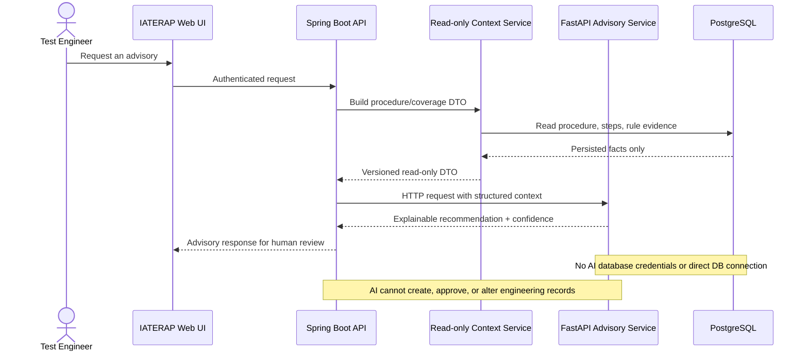

# IATERAP API: Read-only AI context

| Document Information | Details |
|---|---|
| Jira | AI-234 / T13-A2 |
| Endpoint | `GET /api/ai/context/test-procedure/{id}` |
| Authentication | Authenticated JWT user |
| Contract version | `1.0` |
| Side effects | None |

## Purpose

This endpoint is the isolation boundary between the Spring Boot application and
the AI Advisory Service. It returns a point-in-time, structured view of one
test procedure, its ordered steps, and the deterministic coverage evidence the
backend has calculated for that procedure. The consumer receives facts and
coverage gaps; it does not receive a repository handle or a write capability.

## Response shape

```json
{
  "contract_version": "1.0",
  "test_procedure_id": 42,
  "name": "Altitude signal validation",
  "description": "...",
  "lru_id": 7,
  "approval_status": "IN_REVIEW",
  "version_number": 3,
  "step_count": 1,
  "steps": [
    {
      "test_step_id": 101,
      "execution_order": 1,
      "interface_name": "ARINC429_BUS_A",
      "connector_name": "J1",
      "signal_library_name": "ALT_ENCODED",
      "protocol_tag_name": "ARINC429",
      "fault_category_name": "SIGNAL_OUT_OF_RANGE",
      "expected_behaviour": "Altitude stabilizes within tolerance.",
      "expected_range": "0-50000 ft",
      "expected_unit": "FEET",
      "acceptance_criteria": "Within +/-50 ft.",
      "pass_fail_criteria": "Pass after 10 seconds in tolerance.",
      "approval_status": "DRAFT"
    }
  ],
  "coverage_context": {
    "categories": { "COVERAGE-INTERFACE": 100.0 },
    "weights": { "COVERAGE-INTERFACE": 0.15 },
    "composite_score": 53.0,
    "threshold_results": { "COVERAGE-INTERFACE": true },
    "unavailable_reasons": {},
    "coverage_gaps": [
      {
        "element_type": "SIGNAL",
        "element_id": 19,
        "description": "Unreferenced signal: ALT_DISCRETE"
      }
    ]
  },
  "retrieved_at": "2026-09-30T09:00:00Z"
}
```

`coverage_context` is evaluated from the current persisted procedure steps and
the enabled coverage-rule configuration. If a category has no authoritative
catalog, its score is `null` and `unavailable_reasons` explains why. Gap
descriptions are deterministic backend facts; no AI inference is performed by
this endpoint.

## Isolation guarantees

- Only `GET` is mapped under `/api/ai/context`.
- The endpoint does not create a procedure revision, coverage report, audit
  row, validation run, or reviewer comment.
- A missing procedure returns `404`; unauthenticated requests return `401`.
- Unsupported methods return `405` and never reach a write service.
- The response is a DTO snapshot, not a JPA entity, so consumers cannot mutate
  persisted relationships through deserialization.

## AI service isolation sequence (AI-250)



The Spring application owns authentication, authorization, persistence, and
all write workflows. FastAPI is an independently deployed decision-support
service. It receives an explicit DTO over HTTP and returns a recommendation;
the Test Engineer remains responsible for reviewing it through the normal
procedure and approval workflow.
