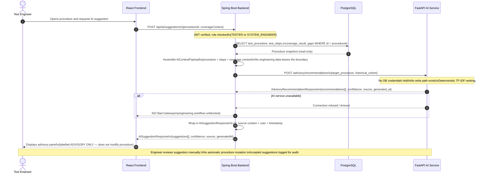

# Architecture: AI Service Isolation — Sequence Diagram

**AI-250 / T14-DOC** — Sec 18.1 of the IATERAP Software Project Proposal.

This document describes the read-only context boundary between the Spring Boot
backend and the FastAPI AI Advisory microservice, with an explicit sequence
diagram of every step in the context-assembly and advisory-recommendation flow.

---

## Design principles

1. **Read-only boundary** — the AI Advisory service holds no database credentials
   and has no write path into any engineering table. It receives a snapshot of
   engineering context assembled by the Spring backend and returns a structured
   recommendation. It cannot modify procedures, coverage results, approval state,
   or any other persisted engineering artefact.

2. **Architectural independence** — the AI service runs as a separate process
   (FastAPI / Uvicorn), contactable only via HTTP. The Spring backend treats it
   as an optional, fallback-safe dependency: if the service is unavailable, the
   backend returns `502 Bad Gateway` and logs the failure; no engineering
   workflow is blocked.

3. **Explainable, deterministic output** — recommendations are produced by
   reproducible TF-IDF cosine similarity ranking, not a generative model. Every
   response includes a `confidence` score, a `source` tag, and a `generated_at`
   timestamp so the basis of every suggestion is auditable.

4. **No live telemetry, no classified data** — the context payload contains only
   the synthetic engineering data already governed by the Sec 3.2 Synthetic Data
   Notice. The service never receives real aircraft readings or Adtech-internal
   test measurements.

---

## Sequence diagram — read-only context flow

---

## Boundary enforcement — what the AI service cannot do

| Action | Backend | AI Service |
|---|---|---|
| Read procedure / test step data | Yes (via DB) | No (context snapshot only, from Spring) |
| Write to any engineering table | Yes (controlled) | **Never** — no DB credentials |
| Approve or reject a procedure | Yes (via approval workflow) | **Never** |
| Modify coverage results | Yes (via Coverage Engine) | **Never** |
| Call external AI model APIs | No | No (deterministic local ranking only) |
| Access real aircraft telemetry | No | No |

---

## Runtime configuration

| Property | Development | Docker Compose |
|---|---|---|
| AI service base URL | `http://127.0.0.1:8000` | `http://ai-service:8000` |
| Spring client bean | `AiAdvisoryClient` | same |
| FastAPI entry point | `uvicorn app.main:app` | same |
| Health check endpoint | `GET /health` | same |
| Advisory endpoint | `POST /advisory/recommendations` | same |
| Context contract endpoint | `GET /context/test-procedure/{id}` | same |

---

## Related documents

- `docs/API_AI_CONTEXT.md` — OpenAPI contract for the context endpoint
- `docs/AI_SERVICE_INTEGRATION.md` — Spring-to-FastAPI integration runtime notes
- `ai-service/README.md` — FastAPI service setup and local development guide
- Proposal Sec 18.1 — AI Service Isolation architectural requirement
- Proposal Sec 3.2 — Synthetic Data Notice (governs all data in context payloads)