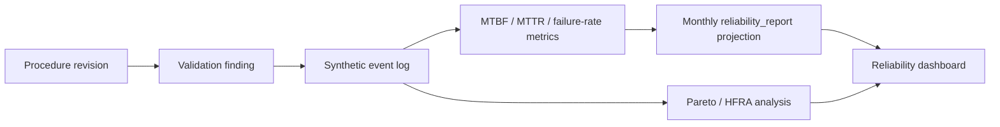

# Month 4 Validation Pack and Progress Report (Weeks 13-16)

## Purpose

This pack is the evidence set for the Month 4 milestone. It covers AI advisory safety, persisted synthetic reliability analytics, reporting projections, Pareto/HFRA analysis, and the user-facing dashboard.

## AI-265 - Demo rehearsal checklist

1. Sign in as a Test Engineer and open **AI Suggestions**.
2. Request a suggestion for a specific procedure and test step.
3. Explicitly accept the suggestion. Confirm it is attributed to the signed-in engineer.
4. Open the same procedure in **Procedure Builder**, apply the accepted suggestion, and save the normal procedure revision.
5. Confirm the step remarks retain the acceptance attribution and that no content changed before the engineer saved.
6. Generate synthetic events for a seeded aircraft, open Reliability Analytics, and show the current reporting projection and Pareto/HFRA view.

All values shown in this rehearsal are synthetic. The presenter must not describe them as live aircraft telemetry.

## AI-266 - Reporting-table read performance protocol

The report read path is `GET /api/reliability/reports/current`. It uses the indexed `(period_start DESC, lru_id)` report projection and reads pre-calculated rows; it does not recompute event-derived metrics during the request.

Run the `ReliabilityReportingReadPerformanceTest` after loading the full synthetic fleet. The test creates an in-memory representative result set of 10,000 report rows and verifies that service-to-response mapping finishes within one second. The API remains read-only; no new table is introduced by the test.

## AI-267 - Timed end-to-end regression

The automated contract covers the critical chain:

`approved/revisioned procedure -> persisted validation finding -> synthetic failure and repair events -> reporting refresh -> current report read`

The timed regression limit is one second for the in-memory reporting refresh/read portion. The existing database integration test verifies event persistence and idempotency against the synthetic-data profile. Together, these checks keep the dashboard query independent of expensive recalculation.

## AI-268 - Architecture v0.4

### Reliability flow



### AI advisory boundary

The FastAPI service receives only structured request context and has no database credentials. A suggestion remains pending until the requesting engineer accepts it. Applying an accepted suggestion in Procedure Builder changes only the unsaved draft; the normal save flow creates the attributable engineering revision.

### Week-by-week delivery

| Week | Delivered capability |
|---|---|
| 13 | Fault-injection storage, synthetic LRU/event model, read-only AI context |
| 14 | Similarity advisory, confidence evidence, FastAPI/Spring integration, synthetic event generation |
| 15 | Suggestion queue, reliability formulas, scheduled reporting projection |
| 16 | AI isolation proof, accepted-suggestion Builder flow, Pareto/HFRA analytics, Recharts dashboard, validation pack |

## Verification commands

```powershell
cd backend
./mvnw -q -Dtest=SyntheticEventGenerationIntegrationTest,ReliabilityReportingReadPerformanceTest,ReliabilityPipelineTimingTest test

cd ../frontend
npm run build
```
